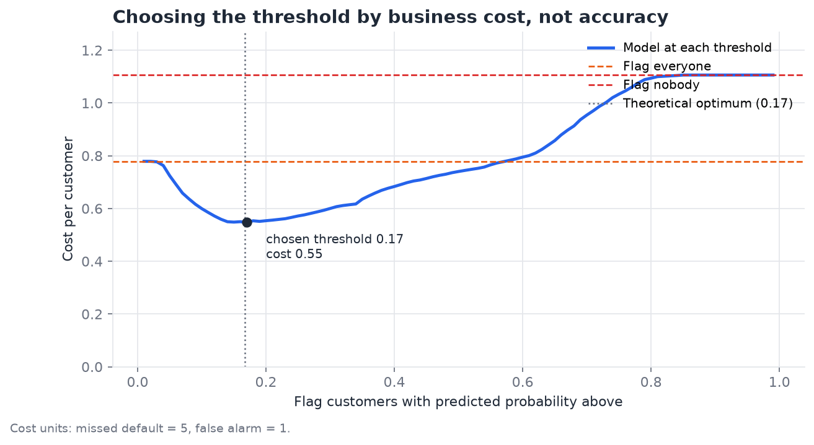
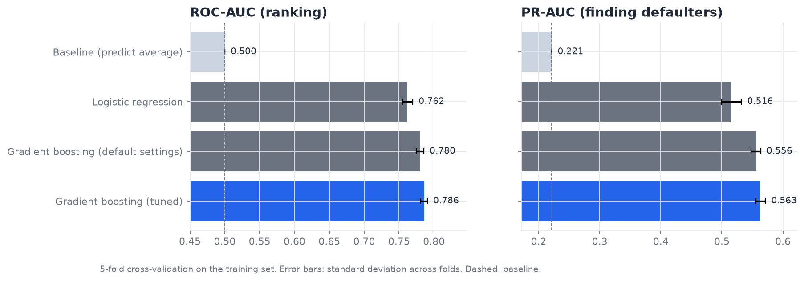
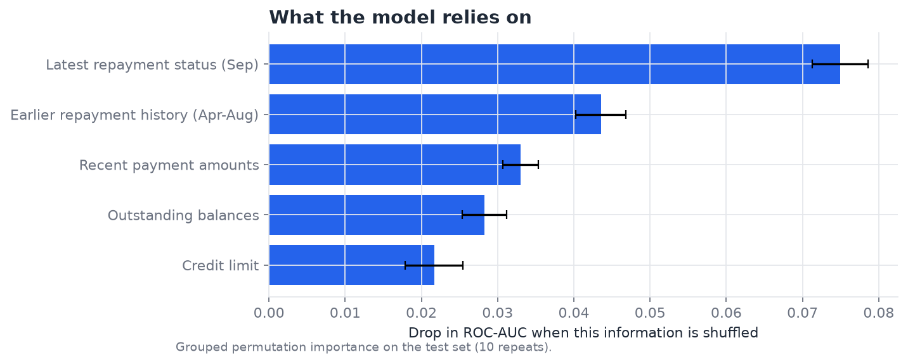
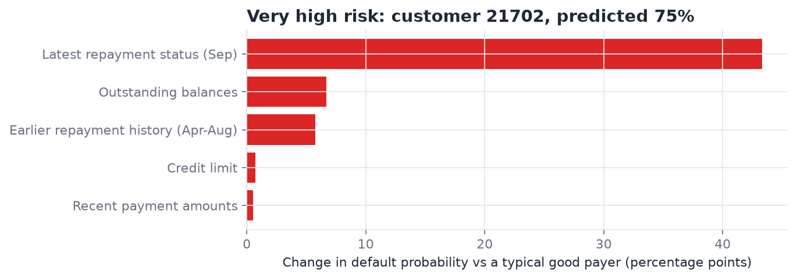
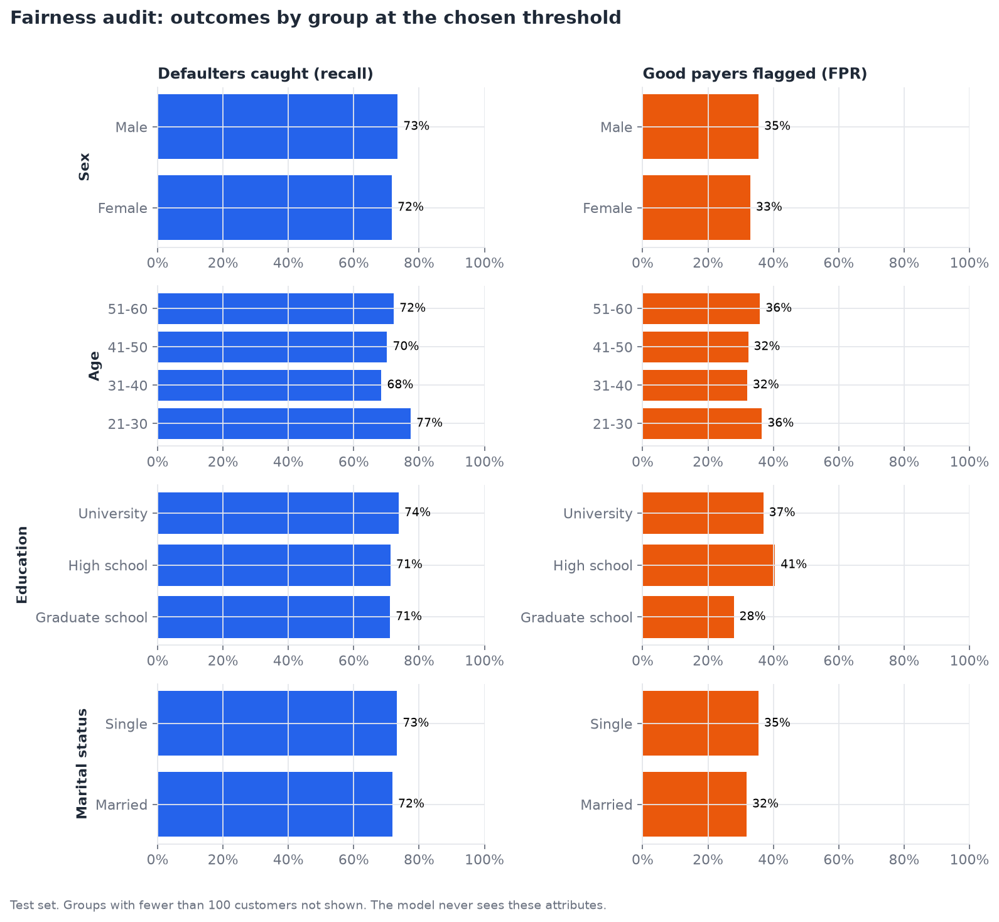

# Credit Risk Scorer


**Predicts which credit card customers will miss next month's payment, explains each prediction, and turns it into a decision based on what each kind of mistake costs.**

Built on 30,000 real customers of a Taiwanese bank. The emphasis is on what makes a credit model usable in practice: probabilities that can be trusted, a decision threshold set by business cost instead of accuracy, reasons for every score, and an audit of how decisions differ across demographic groups.

## Results

| | Test set (6,000 customers, held out until the end) |
|---|---|
| **ROC-AUC** | **0.780** (cross-validated estimate: 0.786) |
| **PR-AUC** | **0.558** (no-skill baseline: 0.221) |
| **Calibration** | Predicted and observed default rates within ~2 points in every decile |
| **Decision policy** | Flags 42% of customers and catches **72% of defaulters** |
| **Business value** | **27% lower cost** than the best strategy without a model |

<p align="center">
  
</p>

## What makes this different from a typical credit-default project

1. **The threshold comes from business costs, not 0.5.** If missing a defaulter costs 5× a false alarm, the theory for calibrated probabilities says to flag customers above 1/6 ≈ 0.17. The cost-minimising threshold found in the data is **0.17**, an independent confirmation that the probabilities are calibrated. The app lets users change the costs and watch the policy adapt.
2. **Probabilities are checked, not assumed.** The model is tuned on log loss, and calibration is verified overall and within every demographic group.
3. **Demographics are excluded and then audited.** Sex, age, education and marital status are not model inputs. Including them improved ROC-AUC by only 0.002. They are kept solely to audit decisions (see below).
4. **Every score comes with reasons**, in terms a credit officer would use ("latest repayment status raises the risk by 43 points").
5. **The data's quirks are investigated.** Undocumented repayment codes (−2, 0) are decoded from the balances, a column-naming gap (`PAY_0`, `PAY_2`, ...) is fixed, and an inconsistency in how "1 month late" was recorded is documented.
6. **Engineered, tested, reproducible.** One training command, 32 tests (including the app), CI, pinned dependencies, and a test set used exactly once.

## Model development

<p align="center">
  
</p>

- **Baseline → logistic regression → gradient boosting**, all compared with 5-fold cross-validation on the training set only.
- **Feature engineering** (utilisation, payment-to-bill ratios, months in each repayment status) lifted logistic regression from 0.722 to 0.762 ROC-AUC.
- **Histogram gradient boosting**, tuned by random search on log loss, is the final model. The top tuning results are nearly tied, so the result isn't fragile.
- Test performance (0.780) closely matches the cross-validated estimate (0.786): no overfitting to the data or to the tuning process.

## Explanations

<p align="center">
  
  
</p>

- **Global:** grouped permutation importance shows that the latest repayment status matters most, followed by earlier repayment history.
- **Per customer:** each group of inputs is replaced by the profile of a typical customer who paid, and the change in predicted risk is that factor's contribution. It's simple, model-agnostic and easy to verify; it can't capture every interaction between factors.

## Fairness audit

<p align="center">
  
</p>

- **Well calibrated for every group**: predicted risk matches actual default rates to within 2 points for every sex, age band, education level and marital status.
- **Recall is nearly equal across sexes** (2-point gap): defaulting men and women are caught at the same rate.
- **False positive rates differ by education** (28% for graduate school vs 41% for high school). The gap follows a real difference in default rates (19% vs 26%). When groups' true rates differ, a model cannot be both calibrated within groups and have equal false positive rates, so a bank must choose which criterion matters for each use. That's a policy decision, documented here instead of being settled silently in code.

## The app

```bash
streamlit run app/streamlit_app.py
```

- **Score a customer:** start from a real test-set customer, edit their limit, repayment status, balances and payments, and see the probability, risk band, decision and reasons update live.
- **Decision policy at work:** change the cost of each mistake in the sidebar and see the threshold, flag rate, defaulters caught and total cost on the 6,000 test customers.
- **About the model:** metrics, inputs, fairness summary and limitations.

## Limitations

- **One bank, 2005.** Customer behaviour, products and economic conditions differ today and elsewhere; the model would need retraining and validation before any real use.
- **The costs are illustrative.** A real deployment would estimate them from the bank's loss and operations data.
- **One-month horizon** only.
- **Explanations** replace one group of inputs at a time, so they can't capture every interaction. SHAP values would be the natural next step.

## Project structure

```text
src/credit_risk/
  config.py        every assumption in one place: columns, costs, risk bands, seeds
  data.py          loading, validation, cleaning, train/test split
  features.py      feature engineering (used inside the model pipeline)
  models.py        baseline, logistic regression, gradient boosting, tuning
  evaluation.py    metrics, calibration, cost-based threshold
  explain.py       grouped permutation importance, reason codes
  fairness.py      per-group audit
  train.py         end-to-end pipeline: python -m credit_risk.train
app/               Streamlit app
notebooks/         01 data understanding · 02 model evaluation · 03 explainability & fairness
models/            trained model + metadata (hyperparameters, metrics, threshold, versions)
reports/           figures and result tables
tests/             32 tests: data, features, metrics, explanations, fairness, pipeline, app
```

## Run it yourself

```bash
git clone https://github.com/siddharth0444/credit-risk-scorer.git
cd credit-risk-scorer
python3 -m venv .venv && source .venv/bin/activate
pip install -r requirements-dev.txt && pip install -e .

python scripts/download_data.py      # 30,000 rows from UCI, no account needed
python -m credit_risk.train          # ~1.5 minutes; writes models/ and reports/tables/
pytest                               # 32 tests
streamlit run app/streamlit_app.py
```

## Data

[Default of Credit Card Clients](https://archive.ics.uci.edu/dataset/350/default+of+credit+card+clients), UCI Machine Learning Repository (CC BY 4.0). Yeh, I. C., & Lien, C. H. (2009). *The comparisons of data mining techniques for the predictive accuracy of probability of default of credit card clients.* Expert Systems with Applications, 36(2), 2473–2480.

## Author

**Siddharth Rajak** · [LinkedIn](https://www.linkedin.com/in/siddharthrajak) · [GitHub](https://github.com/siddharth0444)
